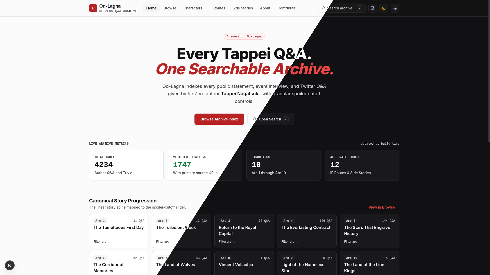
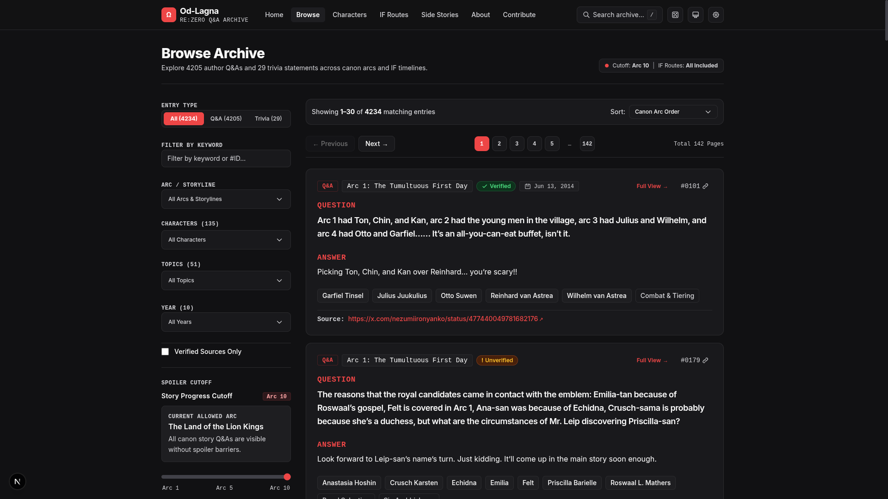
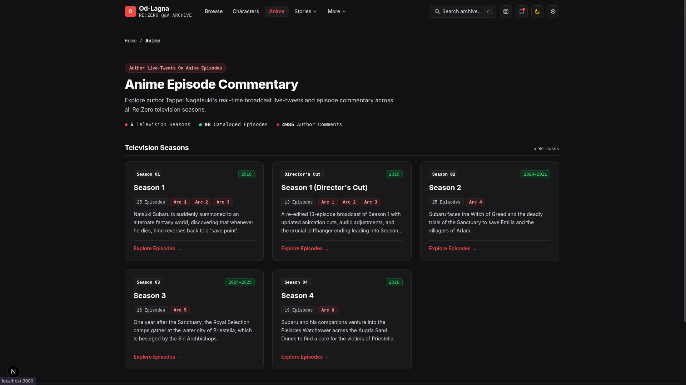
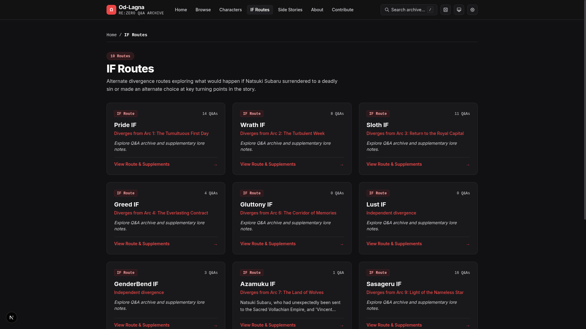
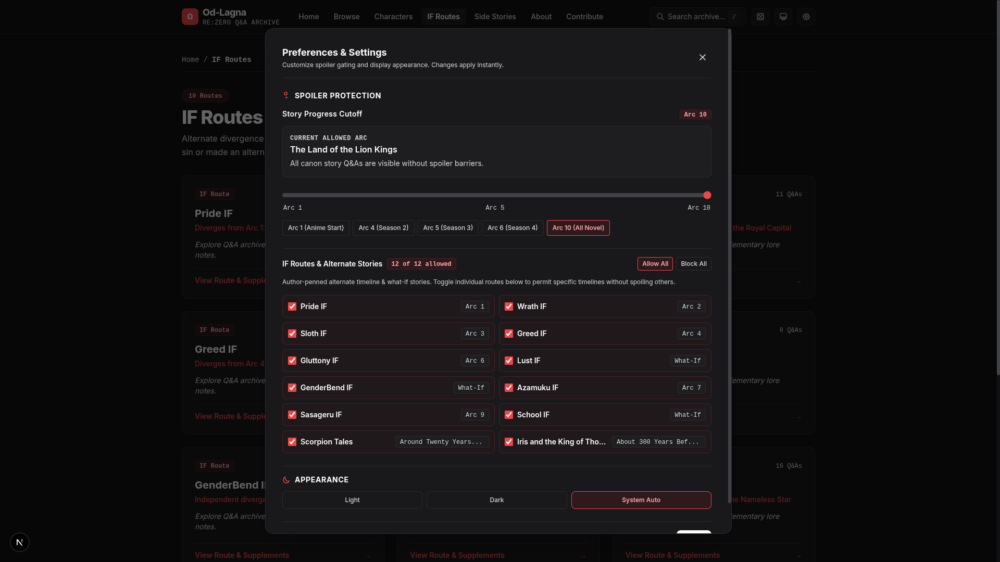

# Od-Lagna

A comprehensive, searchable, spoiler-safe archive of author Q&As, interviews, anime live-tweets, and lore explanations by *Re:Zero kara Hajimeru Isekai Seikatsu* creator **Tappei Nagatsuki**.

[](https://github.com/PixelStarForge/Od-Lagna/releases/latest)
[](https://github.com/PixelStarForge/Od-Lagna/releases/latest)
[](https://nextjs.org/)
[](https://v2.tauri.app/)
[](https://www.typescriptlang.org/)
[](LICENSE)

[Web Application](https://od-lagna.pages.dev) | [Download Native Apps](https://od-lagna.pages.dev/download) | [Browse Archive](https://od-lagna.pages.dev/browse) | [World Timeline](https://od-lagna.pages.dev/timeline) | [Anime Commentary](https://od-lagna.pages.dev/anime) | [Character Profiles](https://od-lagna.pages.dev/characters) | [IF Stories](https://od-lagna.pages.dev/ifs)



---

## Overview

Over the past decade, *Re:Zero* author Tappei Nagatsuki has answered thousands of fan questions across Twitter sessions, convention panels, art books, and magazine interviews, alongside live-tweeting scene-by-scene commentary for television broadcasts. These responses provide indispensable context on cut light novel content, worldbuilding, and alternate timelines, but have historically remained scattered across forums, pastebins, and archived web pages.

Od-Lagna brings together, categorizes, and cross-references these statements into a single, unified archive. Available both as a high-performance web app and as fully self-contained offline desktop and mobile applications, it offers customizable spoiler barriers, per-episode commentary streams, and an interactive 400-year history canvas.

---

## Core Features

- **Granular Spoiler Protection:** Lock statements behind arc thresholds (Arcs 1 through 9, plus anime season equivalents) with independent IF route toggles. Material beyond your active cutoff remains masked until explicitly revealed.
- **Instant Client-Side Search:** Sub-millisecond Fuse.js search across questions, answers, character profiles, topic tags, and entry IDs without sending queries to an external server.
- **Interactive World Timeline:** Continuous 2D canvas documenting canonical history and IF route divergence points spanning over 400 years, complete with semantic level-of-detail tiers, radar minimap scrubbing, and cursor-anchored zoom.
- **Anime Broadcast Commentary:** Over 4,000 author live-tweets, production trivia notes, and scene explanations organized across 98 episodes from Season 1 to Season 4, with direct links to original tweet sources.
- **Bookmarks & Favorites:** Save entries locally in your browser or application. Manage, filter, and sort your collection, with complete JSON backup export/import and shareable URL synchronization.
- **Share & Quote Cards:** Generate and export high-resolution visual quote cards (PNG) formatted with verification badges for sharing on Discord, Twitter/X, and forums.
- **Character Profiles:** Major character dossiers detailing debut arcs, affiliations, aliases, and comprehensive author Q&As.
- **IF Routes & Side Stories:** Directory cataloging what-if web novel routes, standalone side stories, and associated supplementary author commentary.
- **Verified Citations:** Every entry tracks its primary source (original Japanese tweets, convention panels, published fanbooks) with verification status badges.

---

## Interface Showcase

| Browse & Filters | Anime Commentary | IF Routes Directory | Spoiler Protection |
| :---: | :---: | :---: | :---: |
|  |  |  |  |
| Searchable index with character, topic, and arc filters. | Season catalog and episode broadcast live-tweets. | Hubs for alternate storylines and author supplements. | Arc-level gating with independent IF route toggles. |

---

## Contributing

Community contributions ensure this archive remains accurate, properly cited, and comprehensive.

### How to Submit Content
- **New Q&As & Commentary:** Open a GitHub Issue containing the question/comment, translated answer, relevant arc, episode, or IF route, associated character/topic tags, and a verifiable primary source link.
- **Google Doc Submission:** Provide entries directly via the [Public Submission Document](https://docs.google.com/document/d/1-yXkWranORjknet7cxOGEhOuafEilxk6Oaj6-fSMOFw/edit?tab=t.isa9vixpx82s#heading=h.3zujftrfbgoi).
- **Reddit Inquiries:** Direct questions, corrections, or raw transcripts to [u/Mildly_Confused_NPC](https://www.reddit.com/user/Mildly_Confused_NPC) on Reddit.
- **Source Verification:** If an entry is marked unverified and you have the original Japanese source (tweet URL, event recording, magazine publication), submit an issue referencing the entry ID (e.g. `#0042`).
- **Corrections:** Typo fixes, tag updates, and translation improvements are welcome via pull requests.

---

## Local Development

### Prerequisites
- Node.js 20 or newer
- Rust stable toolchain (required only for building native desktop/mobile apps)

### Web Development
```bash
# Clone the repository
git clone https://github.com/PixelStarForge/Od-Lagna.git
cd Od-Lagna

# Install dependencies
npm install

# Start the web development server (http://localhost:3000)
npm run dev

# Validate all content files against Zod schemas
npm run validate

# Run automated schema and content tests
npx tsx lib/schema.test.ts

# Generate static production export
npm run build
```

### Native Desktop Development (Tauri)
```bash
# Run the native desktop application in dev mode with live reload
npm run tauri dev

# Build the native release bundle for your current platform
npm run tauri build
```

---

## Disclaimer and Copyright

Od-Lagna is an unofficial, non-commercial fan project created for archival, reference, and educational purposes under fair use.

*Re:Zero kara Hajimeru Isekai Seikatsu*, its characters, settings, and original Japanese text are the intellectual property of **Tappei Nagatsuki**, **Kadokawa**, and illustrator **Shinichirou Otsuka**.
